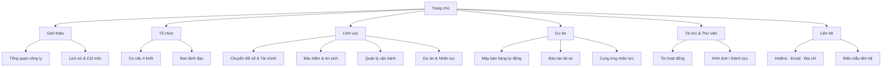

# Giai đoạn 1 · Sitemap website & sơ đồ phân bổ brochure

Nguồn đối chiếu: cấu trúc website trong `tools/site_gen.py` và brochure VBi 10 trang trong `brochure-vbi/build.py`. Đây là bản khung để thống nhất nội dung trước khi thiết kế chi tiết.

## Sitemap website

**Cấp điều hướng:** Trang chủ và 6 trang chính. Các mục cấp dưới là section/anchor trong trang, chưa cần tách thành nhiều URL. Website có chuyển ngữ VI/EN; bản tiếng Anh hiện có ở trang chủ, nên cần xác nhận phạm vi dịch toàn site trước khi bàn giao phát triển. Đường vào brochure nên đặt ở trang chủ và chân trang, trỏ đến bản HTML hoặc PDF được duyệt.

## Sơ đồ phân bổ nội dung brochure VBi

| Trang | Vai trò | Nội dung chính | Tư liệu chủ đạo |
|---|---|---|---|
| 01 | Bìa / nhận diện | Logo, tên công ty, thông điệp, chỉ số nổi bật | Ảnh hoạt động |
| 02 | Tổng quan | Công ty, mô hình hoạt động, giá trị cho đối tác | Ảnh thực tế |
| 03 | Năng lực & tổ chức | Quy mô, điểm chạm, sơ đồ 4 khối và 12 đơn vị | Ảnh hiện trường, org chart |
| 04 | Chuyển đổi số & tài chính | Dịch vụ số, ngân hàng, quy trình triển khai | Ảnh hoạt động / họp đối tác |
| 05 | Bảo hiểm & an sinh | Bảo hiểm, BHXH/BHYT, chi trả bảo trợ | Ảnh tư vấn, chi trả |
| 06 | Hệ sinh thái | Bốn khối, bảy lĩnh vực, lợi thế cạnh tranh | Sơ đồ hệ sinh thái |
| 07 | Dự án trọng điểm | Máy bán hàng, đào tạo lái xe, nhân lực | Nội dung dự án |
| 08 | Lộ trình & lãnh đạo | Mốc 2025–2026, danh sách lãnh đạo | Chân dung thật |
| 09 | Thành tựu & cộng đồng | Hoạt động cộng đồng, thư cảm ơn | Ảnh thật, thư gốc |
| 10 | Hợp tác & liên hệ | Nhóm đối tác, hotline, email, địa chỉ, QR | Logo, QR |

**Luồng đọc:** Nhận diện → Tin cậy → Năng lực → Dịch vụ → Dự án → Bằng chứng → Liên hệ. Mỗi trang có tiếng Việt và tiếng Anh cùng vị trí; ưu tiên kiểm tra độ dài bản dịch trong khung trang trước khi xuất PDF.

**Điểm cần chốt trong giai đoạn 1:** Logo và phiên bản sử dụng; số liệu/chức danh có người xác nhận; thứ tự 10 trang; quyền dùng ảnh và thư cảm ơn; phạm vi dịch VI/EN của website và brochure.
